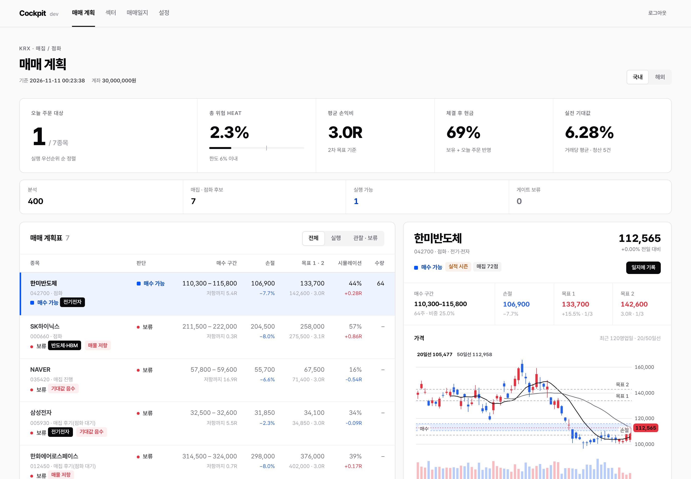
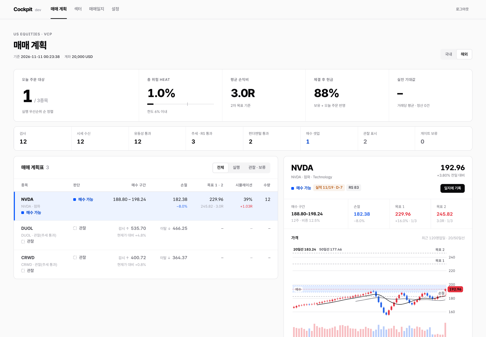
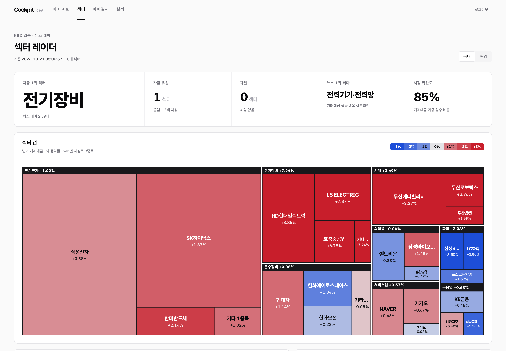
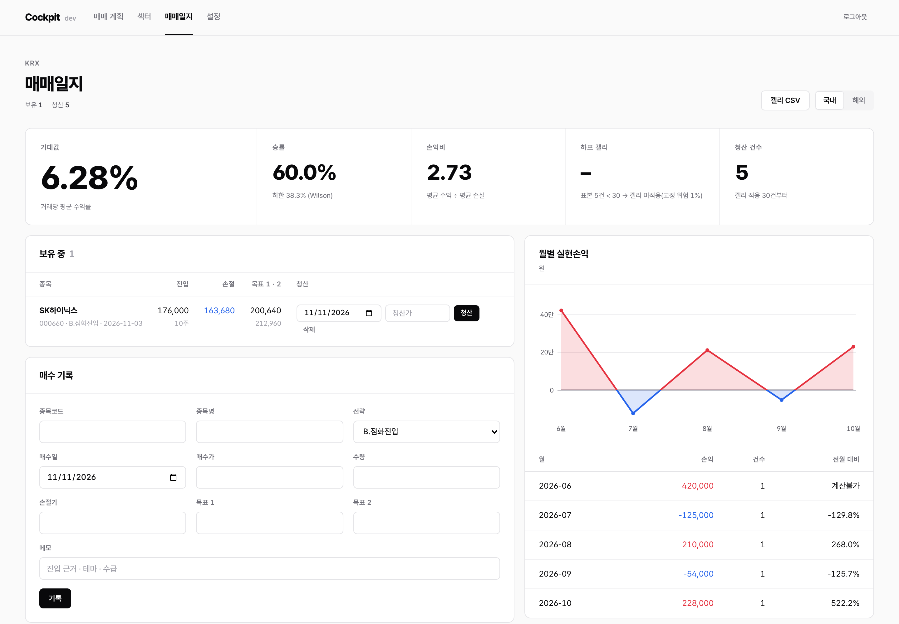
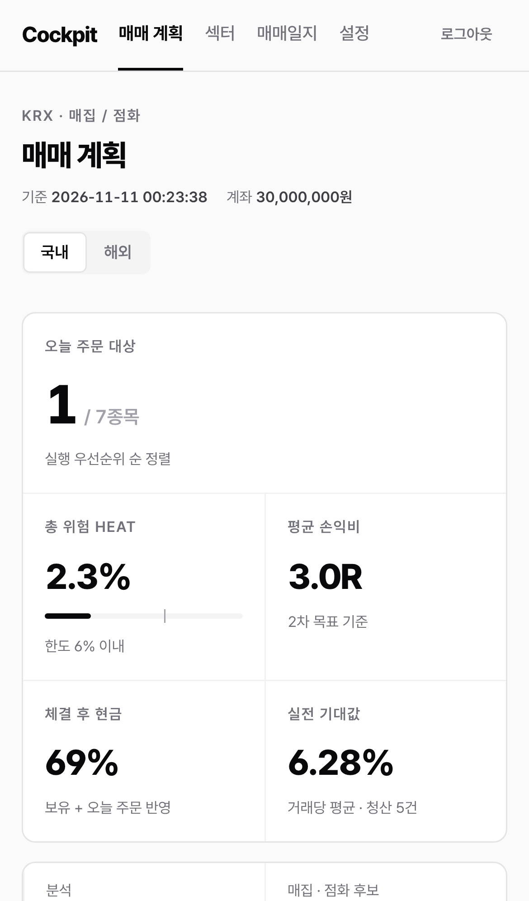

# hogy — AI 보조 주식 스크리너 + 개인용 트레이딩 콕핏

- `screener/` : Python 스크리너(국내 매집·점화 / 해외 VCP) → 하프켈리 매매 계획 JSON
- `web/` : Spring Boot 3 웹앱(1인 로그인) — KPI 대시보드, 매매 계획표·차트, 매매일지 → 실전 켈리 CSV
- **Windows 프로그램**: Actions → `windows-package` → Artifacts 의 `Cockpit-windows.zip` → 압축 해제 → `Cockpit.exe` 더블클릭 (설치 불필요)
- 설치·운영 A–Z: [`docs/WEBAPP_GUIDE.md`](docs/WEBAPP_GUIDE.md)



| 해외 | 섹터 | 매매일지 | 모바일 |
|---|---|---|---|
|  |  |  |  |

> 스크린샷은 합성 일봉으로 스크리너를 실행한 예시 데이터입니다.

| 파일 | 대상 | 1차 필터 철학 |
|---|---|---|
| `screener/us_screener.py` | 미국 | 펀더멘털(분기 매출·희석 EPS YoY, EPS 가속, 영업이익률) + 미너비니 트렌드 템플릿 + RS Rating + VCP(거래량 동반 돌파만 점화) + 매매 계획 |
| `screener/kr_screener.py` | 국내 | 거래대금 폭발 + 외국인·기관 수급 + 20/60/120 정배열 + 과열 배제 + VCP |
| `screener/kr_accumulation.py` | 국내 | 눌림 매집 탐지: 주가 정체 + 기관·외국인 누적 순매수(상장주식 대비) + 숏커버 배제 → 점화 신호 |
| `screener/accumulation.py` | 공통 | 매집 단계 판정 순수 로직(매집 진행 / 점화 대기 / 점화) |
| `screener/entry_backtest.py` | 국내 | 진입 시점 비교 백테스트: 선진입 vs 점화진입 vs 분할진입(1/3+2/3), 계획과 같은 손절 규칙 + 왕복 비용 0.35% 차감(`BACKTEST_COST`) |
| `screener/support.py` | 공통 | 지지 구간 산출(돌파피벗·AVWAP·매물대·점화봉·20일선 병합) + 추격매수 판정·포지션 사이징 |
| `screener/trade_plan.py` | 공통 | 하프 켈리(Wilson 하한·상한 캡) 사이징 + 매수구간·손절·2R/3R 분할익절·트레일링·클라이맥스 + 호가단위 보정 |
| `screener/plan_screener.py` | 국내 | 매집/점화 후보 → 종목별 매매 계획표 CSV, 포트폴리오 총 위험(Heat) 점검 |
| `screener/sector_radar.py` · `sector_data.py` | 공통 | 섹터·테마 레이더: 업종 거래대금 쏠림 배수·확산도, 뉴스 헤드라인 테마 분류, 해외 섹터/테마 ETF |
| `screener/simulate.py` | 공통 | 일봉 블록 부트스트랩 1만 회 + 과거 재현: 목표/손절 선도달 확률·평균 R. 기대값이 둘 다 음수면 진입 보류(필터 전용, 켈리 미반영) |
| `screener/risk_gate.py` | 공통 | 점수 순 누적 게이트: 총 위험 6% · 동시 6종목 · 동일 업종 2종목 초과분 진입 보류 |
| `screener/events.py` | 공통 | 실적 발표 회피: 해외 D-5 영업일 이내 신규 진입 보류, 국내 실적 시즌 경고 |
| `screener/export.py` | 공통 | 웹앱 연동용 `output/latest_{kr,us}.json` 내보내기 |
| `screener/common.py` | 공통 | YoY 예외 처리(분모 0·적자 전환), 트렌드 템플릿, VCP 탐지 |

```bash
pip install -r requirements.txt
cd screener && python us_screener.py   # 또는 python kr_screener.py (장 마감 후 실행 권장)
```

## 권장 실행 순서 (국내)

```bash
cd screener
python entry_backtest.py                                   # 1) 승률·손익비 산출 (월 1회 갱신)
python plan_screener.py --account 30000000 \
       --stats entry_backtest_YYYYMMDD.csv                 # 2) 매일 장 마감 후 매매 계획표
```

## 국내 2단계: LLM 테마 태깅 프롬프트

`kr_candidates_YYYYMMDD.csv` 와 최근 3일 뉴스/공시(DART) 헤드라인을 함께 붙여 넣습니다.

```
너는 국내 증시 테마 애널리스트다. 아래 후보 종목 각각에 대해
1) 상승 재료(테마명) 2) 재료 유형(실적/정책/수주/임상/단순 기대감) 3) 동일 테마 내 대장주 여부
4) 재료 지속성(1~5점, 근거 1줄) 5) 이미 노출된 악재(유상증자·CB 전환·대주주 매도)를 표로 정리하라.
뉴스 근거가 없는 항목은 '확인 불가'로 표기하고 추정하지 마라.
```

> 본 코드는 학습·연구용이며 투자 권유가 아닙니다.
